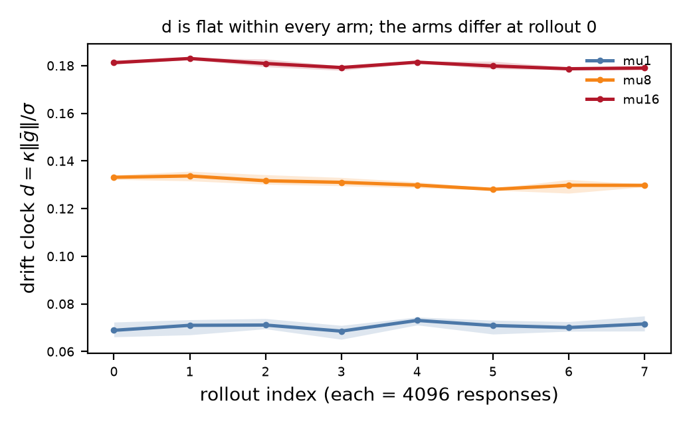
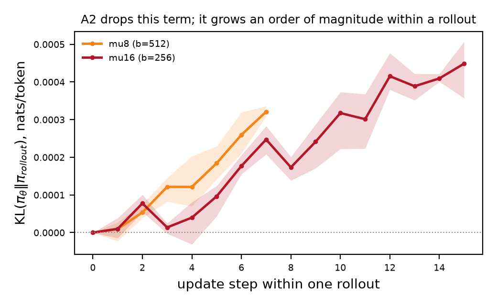
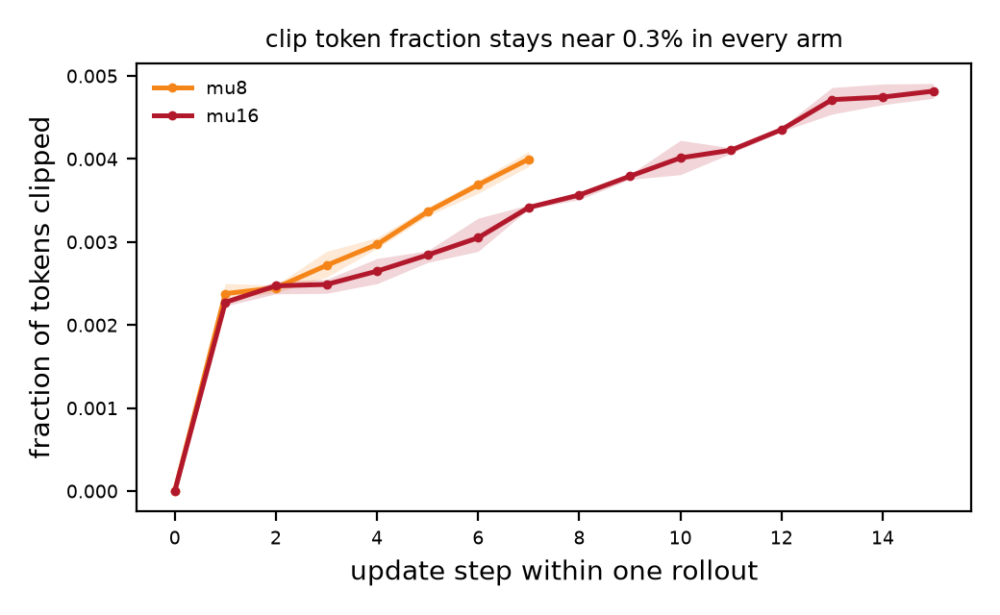
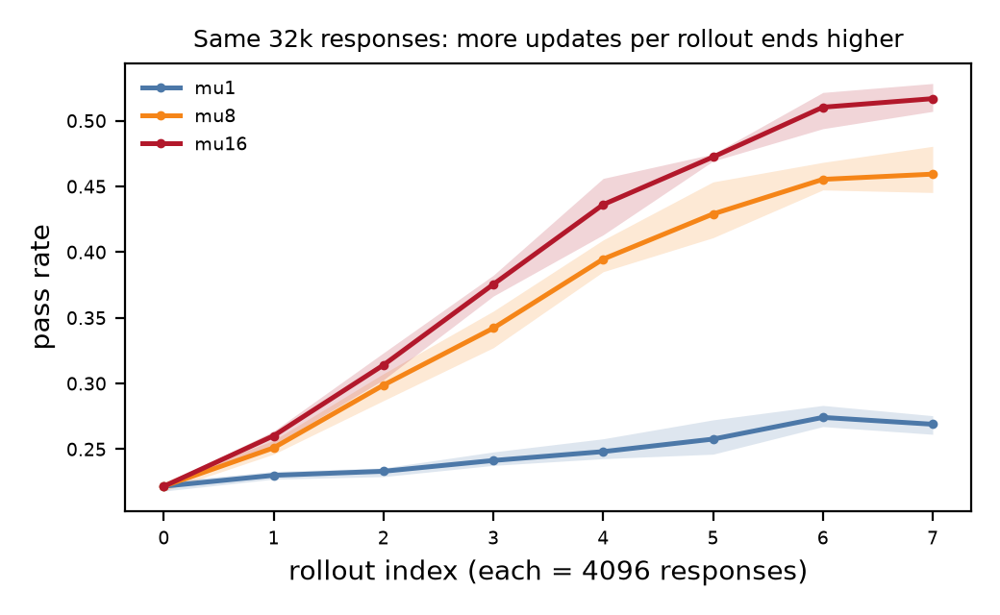

# µ 扫描实验报告：量化 Two Clocks 假设 A2 的代价

> **报告对象**：arXiv:2610.18853（*Two Clocks*）中的假设 A2 —— *"we treat the mini-batches within a rollout as fresh and ignore policy staleness"*。
> **报告性质**：审计（audit）。不复现原文数值，不提出方法改进，只测量 A2 显式忽略的那一项。
> **状态**：数据已全部落地并逐字节校验；本报告只陈述实测与判据对照，**不修改 `analysis/claims.yaml` 的任何 status**（见 §8.4）。

| 项 | 值 |
|---|---|
| 实验日期 | 2026-10-25 14:21 → 2026-10-26 06:06（UTC+8；首个 run `06:21:17Z` 起） |
| 代码版本 | `f04df9f`（云端执行时）；分析脚本为 `ce664a2` 之后 |
| 预注册 | `analysis/claims.yaml`，写定于 2026-10-24（首批 GPU 之前） |
| 数据 | 9 run × 32,768 responses = 294,912 responses；`runs/mu{1,8,16}_s{0,1,2}/` |
| 数据校验 | 608/608 文件 sha256 相符（`notes/2026-10-26_pull/verify_result.txt`） |
| 硬件 | 单卡 RTX 4090 48 GB，¥2.08/h |
| 实耗 | 15.578 GPU-h（9 run 训练墙钟），记账 ¥32.40；容器含探针约 24 h ≈ ¥50 |
| 模型 | Qwen3-1.7B-Base + LoRA r=64/α=16（可训 69.7 M / 1.79 B = 3.89%） |

---

## 0. 摘要

**做了什么。** 在固定 `Br=4096`、`G=8`、每 run 32,768 responses 的同一预算下，只操纵"每批 rollout 被重复用于几次优化更新"这一个变量：µ ∈ {1, 8, 16}（对应每步批大小 b = 4096 / 512 / 256），三个随机种子。三臂共享同一初始权重、同一冻结题池、同一 prompt 序列。

**主结论（预注册 C3）没有被检验，而不是被证伪。** 预注册把 `N_τ` 操作化为"drift clock 达到初始值 2 倍的 rollout 序号"，据此对照论文 Eq.(5) 的 6.1× 预测（C3 文本把这个比值的方向写反了，见 §1.1 脚注；因两端均删失，方向不影响判定）。实测 **9/9 run 的 d/d0 全程落在 [0.926, 1.116]**，阈值一次也没有触发，分子分母双双右删失，比值不存在。这不是"预测错了"，是"这个判据在本配置下不可触发"（§5.2、§7.3）。

**测到了什么。** 四条有实质内容的观测：一条与预注册同向但只部分成立、一条与预注册相反、一条通过、一条是预注册之外的探索性结果。

| 观测 | 数值 | 与预注册 |
|---|---|---|
| A2 忽略的 KL 项在 rollout 内确实累积 | 末步 3.21e-4（µ8）/ 4.49e-4（µ16）nats/token；µ16 是 µ8 的 1.40× | C2 **部分**（净增长成立，逐步单调不成立） |
| 初始 drift clock 随 µ **上升** | d0 0.0689 → 0.1331 → 0.1812（×2.63），3/3 seed 同向 | C4 **相反**（预注册预测下降） |
| 同预算下 µ 越大末段通过率越高 | pass 0.262 → 0.435 → 0.484；配对差 µ8−µ1 +0.167/+0.177/+0.174，µ16−µ1 +0.226/+0.212/+0.228 | **非预注册**（探索性） |
| 响应长度与成本 | 298.3 → 288.3 → 285.4 tok（−4.3%）；单 run ¥3.53–3.67，九次 ¥32.40 | C5、C7 **通过** |

**一句话。** 本次实验没有给出 `N_τ` 的比值——判据在 8 个 rollout 的视界内从未触发；它给出的是：A2 所忽略的陈旧性项在 µ=16 时达到 3.6–5.1e-4 nats/token 且随 µ 增长，而同一预算下通过率的排序是 µ16 > µ8 > µ1（3/3 seed 同向，配对差 0.17–0.23）。

---

## 1. 研究问题与预注册

### 1.1 被审计的对象

论文的 progress clock（Eq.5）给出达到进展阈值 τ 所需样本数

```
N_τ = N_min · (1 + Br / B*),        B* ∝ µ        (Eq.6)
```

固定 `Br` 时增大 µ 会增大 `B*`，于是 `N_τ` 下降——**µ 越大，同样进展越省样本**。按作者在 Remark 7 给出的 `B*(µ=8) ≈ 4k` 线性外推，µ 从 1 提到 16 应使所需样本相差约 **6.1×**（9.2 / 1.5），这是本次要对照的预测值。

> **预注册有一处方向笔误，本报告发现但不修改它**：`claims.yaml` C3 把预测写成 `N_τ(µ=16)/N_τ(µ=1) = 6.1×`，而 6.1× 实际对应的是 `N_τ(µ=1)/N_τ(µ=16)`（9.2 / 1.5 = 6.13）。也就是说 C3 的比值方向与它引用的 6.1× 相反。这不影响本报告的判定——两端都右删失，任何方向的比值都不存在——但按预注册纪律，修订要加 revision 行并留痕，因此保持原样并记录在此（§8.4 待拍板）。

这条预测成立的前提是 Eq.(5) 的推导采用了假设 A2：一个 rollout 内的 µ 个 mini-batch 被当作彼此独立的新数据，陈旧性代价被"另外建模"而不进入 progress 项。**本项目的增量就是把这一项单独测出来**：如果陈旧性有代价，那么 µ 增大在样本口径上的收益会被打折，实测比值应低于 6.1×。

### 1.2 预注册判据

`analysis/claims.yaml` 在首批 GPU 之前写定，共 11 条（C1–C7 为科学判据，D1–D3 为工程默认项，P1 为前置门）。主结论只允许一条：**C3**。其余全部标为探索性，以避免多重比较。

| id | 判据（缩写） | 状态（预注册时） |
|---|---|---|
| C1 | 测量器自检：`mu_step=0` 处新旧策略同源，KL 应为 0 | verified（机制） |
| C2 | `KL(π_θ‖π_rollout)` 在每个 rollout 内随 µ_step 单调上升 | pending |
| C3 | **主结论**：实测 `N_τ(µ16)/N_τ(µ1)` 对照 6.1× | pending |
| C4 | drift clock `d` 随 µ 增大而**下降** | pending |
| C5 | 响应长度不随 µ 系统漂移 | pending |
| C6 | 被 clip 的 token 比例随 µ 升，且其梯度份额高于 token 份额 | pending |
| C7 | 单 run ≤ ¥6、九次 ≤ ¥55 | pending |
| P1 | 通过率是否落在 10–90% 可用区间 | pending（上云前不可知） |

> **下文"通过 / 相反 / 未复现 / 未检验"的语义**：它们指的是**判据与实测的对照结果**，不是 `claims.yaml` 的 status 判定。status 的填写是研究诚信决定，留给作者（§8.4），本报告不代填。

### 1.3 本报告与预注册的关系

三条纪律，全部遵守：

1. **不改措辞、不改阈值、不填 status。** 报告只给证据与判据的对照；`claims.yaml` 保持预注册原样，`analysis/trace.py --strict` 显示 11 条全部 `[ok]`（pending 7 / verified 1 / default 3），即无人事后修改。
2. **预注册结果与探索性结果分开陈述。** 凡预注册未包含的量（如"同预算通过率排序"），一律标注**探索性**，不得作为主结论使用。
3. **不使用"显著"字样。** 三个种子给不出可信区间，只报逐 seed 配对差与其离散范围。

---

## 2. 原文索引（被审计对象的定位）

> 依据 `jd-lab/discussions/2026-10-24_TwoClocks精读_核心发现与局限.md` 的阅读记录。位置为章节级，非页码级。

| 量 | 原文位置 | 原文表述（摘要） | 本项目的用法 |
|---|---|---|---|
| drift clock | Eq.(3) | `d = κ‖ḡ‖/σ`，batch-invariant | `src/grpo.py:drift_clock` |
| progress clock | Eq.(4) | `r(b) = r₀ − C_curv·b` | 不直接测量，只用于解释 |
| 静止点 | Eq.(5) | `N_τ = N_min(1 + Br/B*)` | 主结论的"预测值"一侧 |
| `B*` 闭式 | Eq.(5)(6) | `B* = µ(2σ‖ḡ‖²/(κ ḡᵀHḡ) − B_noise)`，**B\* ∝ µ** | 6.1× 的来源：取 `B*(µ=8)≈4k` 按 ∝µ 外推得 500/4,000/8,000，代入 Eq.(5) 得 `N_τ/N_min` = 9.2/2.0/1.5 |
| 失败时钟 | Eq.(7)(8) | `N_fail = C√b/η` | 未检验，只作观察 |
| 重要性比对数展开 | Eq.(9) | µ 次更新的 off-policy 修正 | 对应 `kl_per_rollout_policy` |
| 假设 A2 | §假设列表 | *"we treat the mini-batches within a rollout as fresh and ignore policy staleness…"* | **被测量的对象** |
| Table 1 | §实验设置 | S/M/L/XL：`Br=512/1536/4096/8192`、`G=8`、`µ=8` | 本项目取 L 档 `Br=4096` |
| Table 2 | §结果 | `N_.15` 的 L/S=1.40、1.72、2.34 | 只作参照，不是目标 |
| 种子噪声 | §结果 | `D_AUC` 0.005–0.009 | 判断"变化是否超过噪声"的门槛依据 |
| clip 现象 | §结果 | clip 占 0.5% token，却占 50–70% 梯度范数 | `clip_frac_any` + `clip_grad_mass_share` |
| 计算量 | App. B | 每 run 4×A6000，全程约 2000 GPU-h | 预算对比的分母 |
| 响应长度 | 全文 | **0 处报告** | 本项目新增观测项 |
| 代码 | — | 仓库 404（三重核对） | 因此只能重建，不能复用 |

---

## 3. 方法

### 3.1 为什么自写训练循环

TRL 1.16 的 `GRPOConfig.num_iterations` 能表达 µ，但**不暴露** per-µ-step 的 `KL(π_θ‖π_rollout)`、被 clip token 的梯度份额、以及 micro-batch 间的梯度散度 σ。这三者正是 A2 代价的直接观测面，因此改为自写循环（约 400 行），正确性用独立标量实现 + 有限差分自证（`tests/test_grpo.py`，12 项测试跨 py3.10/3.11/3.12 与 torch 2.9.1/2.11.0 全绿）。

### 3.2 观测量及其定义

| 量 | 定义 | 字段 | 说明 |
|---|---|---|---|
| `d` | `κ‖ḡ‖/σ`，`ḡ` 为一步内的平均梯度，σ 为 micro-batch 间梯度标准差 | `drift_d` | κ=1.0 仅量纲约定，所有比较只用比值 |
| `σ` | micro-batch 梯度散度（组大小 8，不随 b 缩放） | `grad_noise_sigma` | **口径要点**：σ 的估计窗口固定为 8 条 response，故不随 µ 缩放 |
| `KL` | `KL(π_θ‖π_rollout)`，逐 token、fp32 logsumexp | `kl_per_rollout_policy` | 采样估计（k1 类），早期步噪声可盖过信号 |
| `clip_frac_any` | 被任一方向 clip 的 token 占比 | 同名 | token 口径 |
| `clip_grad_mass_share` | 被 clip 的 token 在**未 clip 代理损失**里所占的 `\|ratio·A\|` 质量份额 | 同名 | logprob 空间；**不是**参数空间范数份额 |
| `pass_rate` | 该 rollout 全部 response 的 verifier 通过率 | 同名 | 每 rollout 一个值，跨 µ_step 重复出现 |

**N_τ 的操作化**（预注册 C3）：`d/d0` 首次达到 2 的 rollout 序号（0-based），未达到记 censored。这是 progress clock 的**代理**——真正的 progress 需要 held-out 评估曲线，本次没有测量。这条代理是 §7.3 讨论的核心威胁。

### 3.3 三臂设计

| arm | µ | b = Br/µ | 更新步/rollout | micro-batch | rollout 数 | responses | seeds |
|---|---|---|---|---|---|---|---|
| mu1 | 1 | 4096 | 1 | 4（组 8） | 8 | 32,768 | 0,1,2 |
| mu8 | 8 | 512 | 8 | 4（组 8） | 8 | 32,768 | 0,1,2 |
| mu16 | 16 | 256 | 16 | 4（组 8） | 8 | 32,768 | 0,1,2 |

**唯一变量是 µ。** 其余全部锁定：同一题池（2000 条 mixed counting，sha256 `d781f955…`）、同一 prompt 序列（`prompt_batch(seed, rollout)` 是纯函数）、同一 `Br`、同一 token 预算、同一优化器与超参、同一 LoRA 配置。

**起点控制（可核实）**：三臂在 rollout 0 的 pass_rate 均值为 0.2217 / 0.2217 / 0.2216。µ1 与 µ8 的三个种子值逐位相同（0.2180/0.2219/0.2251），µ16 为 0.2227/0.2197/0.2224 —— µ 只改变"用几次"，不改变"生成什么"，差异来自 vLLM 采样不跨进程复现（DEVLOG D-16），量级 0.0001。

### 3.4 训练配置

| 项 | 值 | 来源 |
|---|---|---|
| 学习率 | 5e-5，warmup 10%，无 weight decay | 对齐论文 |
| clip | 双段 0.2 / 0.28 + dual clip 10 | 论文 |
| 损失归一化 | 逐 token 均值 | 三臂一致，等价于改 lr |
| 生成长度上限 | 512 | 显存 KV 预算 |
| 采样 | temperature 1.0 / top_p 1.0，每 response 独立 seed，关闭前缀缓存与 chunked prefill | 保证 G 条独立、批次形状固定 |
| 精度 | bf16 训练，fp32 logsumexp 打分 | bf16 打分会让 KL 误差达 1e-3，与信号同量级 |

### 3.5 软件栈

`torch 2.13.0+cu130` / `transformers 5.19.0` / `vllm 0.32.0`（`enforce_eager=true`，镜像无 nvcc）/ `numpy 2.3.2` / 驱动 `580.119.02` / Python 3.11.13。每 run 的 `run_meta.json` 记有以上全部版本、git commit 与 argv。

### 3.6 统计口径

- **配对，不合并。** 三臂共享 seed，故报逐 seed 配对差，不报"三臂均值 ± 合并 CI"。
- **不做跨 seed 的置信区间。** `make_table.py` 在 seed < 3 时明确拒绝打印 CI；本次 n=3，只报三个点与其极差（臂内 pass 极差 0.0071 / 0.0137 / 0.0112）。
- **不插补删失。** 未达到阈值即记 censored，不外推时间常数，不做 Tobit / Kaplan-Meier。

---

## 4. 实验执行

### 4.1 规模与成本

| 项 | 值 |
|---|---|
| run 数 | 9（3 µ × 3 seed），全部 `[OK]` 收尾（`campaign.log`） |
| responses | 9 × 32,768 = 294,912 |
| 训练墙钟 | 15.578 GPU-h（单 run 1.706–1.767 h） |
| FLOPs | 1.611e18（单 run 1.75–1.84e17） |
| 记账成本 | ¥32.40（单 run ¥3.53–3.67，@ ¥2.08/h） |
| 容器总账 | 截至 08:29 已运行 22.73 h ≈ ¥47.3；含全部探针、模型加载与空转 |

单 run 成本 3.53–3.67，远低于 C7 的 ¥6 阈值；九次 32.40 低于 ¥55。**注意 48G 单价是 ¥2.08/h**，与 24G 的 ¥1.56 不同，本战役租的是 48G（49,140 MiB），价签无误。

### 4.2 仪器自检（C1）

这是全部结论的地基，单独列出：

| 检查 | 实测 | 含义 |
|---|---|---|
| `mu_step=0` 的 `ratio_mean` | 72/72 行 `\|ratio−1\| ≤ 1.04e-8`（均值 6.9e-9） | 首次更新前新旧策略就是同一份权重 |
| `mu_step=0` 的 `clip_frac_any` | 72/72 行为 0 | 同上 |
| `mu_step=0` 的 `kl_per_rollout_policy` | 72/72 行为 0 | 同上 |
| 行数 | 8 / 64 / 128，全部 `== 8 × µ` | 无缺行、无重复键 |
| `rollout_idx` | 每个 run 恰好 0..7 连续，每个 rollout 内 `mu_step` 各出现一次 | 循环结构正确 |
| 同预算 | 9/9 run 末行 `responses_cum == 32768` | 三臂可比的前提 |
| 数据不重复 | 3 个 seed 的 `rollout_data_sha` 在（arm, rollout）上无超过 3 个相同值 | 种子确实不同 |

**结论**：测量器接的是真实权重、真实 µ；下面所有数字不是空转的产物。

### 4.3 数据完整性

关机前在云端现场生成 sha256 与字节数清单，本地逐条核对：**608/608 文件相符**（441 个 mu-run 文件含 9 个 `state.pt`，167 个探针/日志文件），另有 599/599 字节数交叉核对。传输为 `tar` 经 ssh 直通（9.4–12.3 MB/s，未压缩）。细节见 `notes/2026-10-26_pull/README.md`。

### 4.4 分析链路上发现并修复的三个缺陷

报告必须记录这一点，因为它们都**只在 µ>1 的臂上发作**——正是主结论关心的臂。三处都已修复并重算，本报告的数字全部来自修复后的版本。

| # | 位置 | 缺陷 | 后果 | 修复 |
|---|---|---|---|---|
| A | `analysis/make_table.py` | `half = len(rows)//2`，把 metric **行数**当 rollout 数 | µ8/µ16 的"后半程"实际是"全程"，pass 被低估约一半，配对差腰斩（+0.089 → +0.167） | 改为按 rollout 数取半（`ce664a2`） |
| B | `analysis/make_table.py` | `load_runs` 用行内 (arm,seed) 作键 + sorted glob 遍历 | 历史探针覆盖正式 run：文档命令 `--runs runs` 得到"1 rollout、512 responses"的假 mu1_s0；bootstrap RNG 共享使其他臂 CI 漂动 | 默认 `--pattern "mu*_s*"`，重复键直接报错 |
| C | `tools/dashboard.html` | feed 的 `KEEP` 白名单不含 `mu_step` | 每行 µ-step 恒显示 0 | 用组内落盘顺序当序号（`ffd2778`） |

**独立交叉验证**：为免"我说修好了"变成断言，云端用 `/opt/conda/bin/python` 直接读 `metrics.jsonl` 复算（`notes/2026-10-26_pull/cloud_stat.py`，不 import 任何本地分析代码），结果与修复后的表格**逐位一致**。本报告的数字另有第三个来源：`analysis/report_stats.py`（不 import `make_table`），输出见 `analysis/out/report_stats.json`。

---

## 5. 结果

### 5.1 主表

三 seed 逐 run（`analysis/out/table.md`）：

| arm | seed | pass（末 4 rollout） | pass 的 rollout 自助 95% | KL@末步 | clip token 份额 | d0 | d_last | resp_len | ¥ |
|---|---|---|---|---|---|---|---|---|---|
| mu1 | 0 | 0.2623 | 0.2561–0.2686 | 0 | 0 | 0.0723 | 0.0686 | 299.5 | 3.675 |
| mu1 | 1 | 0.2656 | 0.2501–0.2745 | 0 | 0 | 0.0682 | 0.0749 | 297.6 | 3.650 |
| mu1 | 2 | 0.2585 | 0.2449–0.2739 | 0 | 0 | 0.0661 | 0.0712 | 297.8 | 3.665 |
| mu8 | 0 | 0.4290 | 0.4100–0.4479 | +3.09e-4 | 0.00264 | 0.1341 | 0.1298 | 289.6 | 3.577 |
| mu8 | 1 | 0.4427 | 0.4056–0.4722 | +3.36e-4 | 0.00270 | 0.1322 | 0.1291 | 286.5 | 3.565 |
| mu8 | 2 | 0.4320 | 0.3944–0.4602 | +3.18e-4 | 0.00275 | 0.1330 | 0.1303 | 288.6 | 3.625 |
| mu16 | 0 | 0.4883 | 0.4653–0.5112 | +5.07e-4 | 0.00335 | 0.1822 | 0.1799 | 285.3 | 3.565 |
| mu16 | 1 | 0.4771 | 0.4333–0.5197 | +4.82e-4 | 0.00333 | 0.1810 | 0.1789 | 284.2 | 3.532 |
| mu16 | 2 | 0.4862 | 0.4542–0.5182 | +3.57e-4 | 0.00331 | 0.1805 | 0.1781 | 286.7 | 3.549 |

按臂聚合（3 seed 均值，方括号为极差）：

| arm | µ | b | pass（末 4） | KL@末步 | clip token | d0 | ‖ḡ‖@r0 | σ@r0 | σ/‖ḡ‖ | resp_len | zero-var 组 |
|---|---|---|---|---|---|---|---|---|---|---|---|
| mu1 | 1 | 4096 | **0.2621** [0.2585–0.2656] | 0 | 0 | **0.0689** [0.0661–0.0723] | 0.00454 | 0.06596 | 14.53 | 298.3 | 0.0033 |
| mu8 | 8 | 512 | **0.4345** [0.4290–0.4427] | 3.21e-4 | 0.00270 | **0.1331** [0.1322–0.1341] | 0.00885 | 0.06652 | 7.52 | 288.3 | 0.0361 |
| mu16 | 16 | 256 | **0.4839** [0.4771–0.4883] | 4.49e-4 | 0.00333 | **0.1812** [0.1805–0.1822] | 0.01221 | 0.06733 | 5.51 | 285.4 | 0.0417 |

配对差（同 seed，末 4 rollout 口径）：

| seed | µ8 − µ1 | µ16 − µ1 | d0 比 µ8/µ1 | d0 比 µ16/µ1 |
|---|---|---|---|---|
| 0 | +0.1666 | +0.2260 | 1.854 | 2.519 |
| 1 | +0.1771 | +0.2115 | 1.938 | 2.654 |
| 2 | +0.1735 | +0.2277 | 2.012 | 2.730 |
| 均值 | **+0.1724** | **+0.2217** | 1.932 | **2.631** |

三个种子的配对差极差：µ8−µ1 为 0.0105，µ16−µ1 为 0.0162，都远小于效应本身；9 个差值的符号全部相同。

### 5.2 C3（主结论）：判据不可触发，比值不存在

| 检查 | 实测 |
|---|---|
| `cross(d/d0 ≥ 1.5)` | 9/9 run 全部 censored |
| `cross(d/d0 ≥ 2.0)` | 9/9 run 全部 censored |
| d/d0 逐 rollout 的取值范围 | µ1 [0.926, 1.116]、µ8 [0.955, 1.012]、µ16 [0.983, 1.014] |



**d 在 8 个 rollout 内是一个平稳量，不是增长量。** 三条臂的 d 轨迹各自都在 ±12% 内波动，臂间差异几乎全部由第 0 个 rollout 决定（§5.3）。因此：

- `N_τ(µ1)` 与 `N_τ(µ16)` 都 > 8 rollout，**两个数都测不到**，比值无从计算；
- 6.1× 这个预测值**没有被检验**，既不能称"证实"，也不能称"证伪"；
- 更准确的说法是：**预注册的操作化在本配置下不可触发**。这是判据设计问题（§7.3），不是数据缺失——数据是完整的（§4.2、§4.3）。

一个必须写明的对比：**三臂在 rollout 0 的 pass_rate 都是 0.222，到末段 µ16 达到 0.484，模型明显在学**，而三臂的 d 都在 ±12% 内几乎不动。这说明"d/d0 翻倍"与本任务的实际进展不对应——progress 在涨，drift clock 不涨。

### 5.3 C4：初始 drift clock 随 µ **上升**，方向与预注册相反

预注册假设："b = Br/µ 变小 → 梯度噪声相对变大 → d 下降"。实测：

| arm | d0 | ‖ḡ‖@r0 | σ@r0 | σ/‖ḡ‖ |
|---|---|---|---|---|
| µ1（b=4096） | 0.0689 | 0.00454 | 0.06596 | 14.53 |
| µ8（b=512） | 0.1331 | 0.00885 | 0.06652 | 7.52 |
| µ16（b=256） | 0.1812 | 0.01221 | 0.06733 | 5.51 |

拆解：**‖ḡ‖ 涨 2.69×，σ 只涨 1.02×**，于是比值升 2.63×。σ 几乎不变的原因在口径里：σ 的估计窗口是固定的 8 条 response（`micro_group_responses: 8`），**不随 b 缩放**；而 ‖ḡ‖ 是实际批上的梯度范数，批越小噪声贡献越大，范数反而上升。

方向判定：预注册要求 d 随 µ **下降**，实测 3/3 seed 同向**上升**，符号相反，`d0` 的配对比值 1.85 / 1.93 / 2.01（µ8）与 2.52 / 2.65 / 2.73（µ16），无一例外。

**解释边界**：预注册的机制猜测（噪声主导）被证伪，但这不等于"论文错了"。实测的"d0 随 µ 升"与同预算 pass 排序（§6）方向一致，都指向"µ 大时单位数据更有效"；而论文 Eq.(6) 的 `B* ∝ µ` 恰好预测 µ 大更省样本。**两者方向是否一致，取决于 d 到 N_τ 的映射，本实验没有独立测 progress，故不作断言**（§7.3）。

### 5.4 C2：净增长成立，逐步单调不成立

| run | 相邻 µ-step 上升比例 | monotonish（≥80% 上升且净增） | 负 KL 行数 | KL@step1 | KL@末步 |
|---|---|---|---|---|---|
| mu8_s0 | 64.3%（36/56） | 1/8 rollout | 11 | +2.73e-5 | +3.09e-4 |
| mu8_s1 | 66.1%（37/56） | 1/8 | 17 | −2.28e-5 | +3.36e-4 |
| mu8_s2 | 64.3%（36/56） | 2/8 | 14 | +2.37e-5 | +3.18e-4 |
| mu16_s0 | 51.7%（62/120） | 0/8 | 29 | +3.88e-5 | +5.07e-4 |
| mu16_s1 | 56.7%（68/120） | 0/8 | 24 | +5.55e-6 | +4.82e-4 |
| mu16_s2 | 50.0%（60/120） | 0/8 | 29 | −1.48e-5 | +3.57e-4 |



三条读法：

1. **按"单调"的字面判据，C2 不通过**：上升比例 50–66%，与抛硬币无异；能称 monotonish 的只有 4/48 个 rollout。
2. **按"净增长"读，C2 成立**：末步 KL 比第 1 步高 11.3–86.8 倍（6 个 run 中 4 个可算：三个落在 11.3–13.4，一个为 86.8；另 2 个 run 首步为负，比值无定义）。
3. **负 KL 每 run 11–29 行**：精确 KL ≥ 0，负值说明这是**采样估计**，早期步的估计噪声大于信号本身。这解释了为什么"逐步单调"不可能被观测到——不是策略不走，是仪器的分辨率在这个量级上不够。

**µ=1 臂的 KL 恒为 0 是结构性的**：每 rollout 只有 1 步，而该步是基線步（step 0），所以"C2 在 µ1 上不可测"是设计的必然，不是结果。

**µ16 的末步 KL 只比 µ8 大 1.40×**（4.49e-4 vs 3.21e-4），**对 µ 是次线性的**：µ 翻倍，陈旧性代价只涨 40%。这一点比"单调与否"更值得进结论。

### 5.5 C5：响应长度无系统漂移

| arm | resp_len（全程均值） | rollout 0 | rollout 7 | 前半 → 后半 |
|---|---|---|---|---|
| µ1 | 298.3 | 292.0–295.0 | 295.4–303.1 | 295.1 → 296.4（+1.3） |
| µ8 | 288.3 | 292.0–295.0 | 273.0–281.3 | 292.5 → 277.2（−15.3） |
| µ16 | 285.4 | 288.9–296.9 | 269.0–274.6 | 290.3 → 272.2（−18.1） |

臂间 −4.3%（298.3 → 285.4）。臂内：µ1 基本平（+1.3 token），µ8/µ16 分别下降 15.3 / 18.1 token（−5.2% / −6.2%）。**无上涨趋势，判据通过**。但"通过"不等于"无差异"：µ 越大，完成长度在训练后期略短——这是一个未预注册的方向（预注册只禁止上涨），值得在后续实验中单独观察，本报告不据此作任何解释。

### 5.6 C6：前半通过，后半未复现

| run | clip token 份额 | clip 梯度质量份额 | 份额比 |
|---|---|---|---|
| mu8_s0/s1/s2 | 0.00264 / 0.00270 / 0.00275 | 0.00236 / 0.00243 / 0.00245 | 0.89× / 0.90× / 0.89× |
| mu16_s0/s1/s2 | 0.00335 / 0.00333 / 0.00331 | 0.00308 / 0.00307 / 0.00302 | 0.92× / 0.92× / 0.91× |

**前半句成立**：clip token 份额随 µ 上升（0 → 0.27% → 0.33%），3/3 seed 一致。
**后半句不成立**：被 clip 的 token 所占的梯度质量份额**低于**其 token 份额（0.89–0.92×），不是论文报告的"0.5% token 占 50–70% 梯度范数"那种超额。6/6 run 同向。



**口径必须声明**：这里测的是 logprob 空间的 `|ratio·A|` 质量份额，**不是参数空间的范数份额**（后者需逐 token 反传，代价是再一遍 backward）。两者不可等同，因此本结果**不能**用来反驳论文的 50–70%——只能说"在 logprob 空间的质量口径下，被 clip 的 token 没有超额权重"。clip 绝对水平也低两个数量级（0.3% vs 论文域），这与任务简单、LoRA 更新幅度小一致。

### 5.7 C7：成本

| 口径 | 算法 | 结果 | 阈值 |
|---|---|---|---|
| 内部记账 | 9 run `cost_cny_cum` 末行之和 | **¥32.40**（单 run 3.53–3.67） | 单 run ≤¥6 ✓，九次 ≤¥55 ✓ |
| 容器墙钟 | 截至 08:29 已运行 22.73 h × ¥2.08 | **¥47.3**（关机时约 ¥50） | ≤¥55 ✓ |

差额 ¥14.9 = 吞吐/确定性探针 + 模型加载 + 队列空档 + 末轮后空转。**两口径都通过。**

### 5.8 P1：通过率落在可用区间

上云前无法知道 1.7B-Base 在这个题池上是否全对或全错。实测 rollout 0 的 pass_rate 三臂均值为 **0.2217 / 0.2217 / 0.2216**，末段为 0.262 / 0.435 / 0.484 —— 全程在 10–90% 内，既非地板也非天花板。**失败时钟有信号可测**，这一点比预期好。

### 5.9 一个离群点的定性

唯一一行 `sigma > 0.15`：`mu16_s2 / rollout 7 / step 3`，σ=0.4017（该臂中位数 0.0805），同行 `grad_norm_raw`=0.0712（中位数 0.0145）。

两者同倍放大（4.4× / 4.6×），`d`=0.1772 完全正常，其余字段（loss 0.0465、clip 0.0022、pass 0.5149、len 274.6）全在分布内。因此这是**尺度事件**（这一步梯度整体大了 4 倍），不是噪声事件；由于 d 是比值，它对 d 序列不可见，也就不影响 C4 与 C3。

---

## 6. 与论文预测的对照

| 量 | 论文预测（A2 下） | 实测 | 判定 |
|---|---|---|---|
| `N_τ(µ1)/N_τ(µ16)` | 6.1×（9.2 / 1.5，B* ∝ µ 外推） | **不可测**：两端均 >8 rollout，右删失 | 未检验 |
| `KL` 累计 @µ16 | 0（A2 假设） | 3.6–5.1e-4 nats/token，且随 µ 增长（µ16/µ8 = 1.40×） | A2 的代价非零，量级已给出 |
| `d` 随 µ | 预注册猜测下降 | 上升 2.63×（3/3 seed） | 预注册猜测被证伪 |
| clip token 份额 | 0.5% 量级 | 0.27–0.34% | 同量级 |
| clip 梯度份额 | 50–70%（范数口径） | 0.89–0.92× token 份额（质量口径） | 口径不同，不可比 |

**探索性结果（非预注册，不得作为主结论）**：在完全相同的 32,768 responses 预算下，末 4 个 rollout 的平均通过率是 µ16 0.484 > µ8 0.435 > µ1 0.262，配对差 +0.222 / +0.172，3/3 seed 同向，配对差的种子间极差 ≤0.017。



这条结果之所以只能标探索性，有三个理由：(a) 它不在预注册里，是看过数据后才被注意到的量；(b) **它测的不是"样本效率"，而是"同数据预算下多做更新步"的效应**——µ 只改变"同一批数据被切成几次更新"（8 / 64 / 128 步），每 token 仍然只被 update 一次，所以三臂的总 response 数相同、总 FLOPs 也几乎相同（1.84 / 1.78 / 1.76e17，4% 的差来自生成长度而非更新量）。真正的样本效率比较需要"达到同一 pass 水平各需多少 responses"，而三臂在 8 个 rollout 内都仍在上升、没有交点，这个比较做不了；(c) 它与 C3 的 `N_τ` 口径不是同一个量，不能互相替代。

换句话说：**"µ 大末段 pass 高"不能读成"µ 提高样本效率"**。样本数一样、算力一样，多出来的是优化步数——这正是审稿时最容易被追问的一点，也是这条结果只能停留在探索性的第三个理由。

值得注意的是：**这条探索性结果与 C4 的实测方向自洽**（都是"µ 大更好"），而与 C4 的预注册机制猜测矛盾。这个内部一致性是本报告最值得记录的一点，也是最需要外部复核的一点。

---

## 7. 有效性威胁

### 7.1 内部效度

| 威胁 | 描述 | 缓解 / 现状 |
|---|---|---|
| **µ 与 b 混杂** | 固定 Br 时 µ 与 b 完全共线，d0 的臂间差异既可能来自陈旧性，也可能来自批大小 | **未缓解**。这是设计的内在限制：想分开需要额外的"固定 b 变 µ"臂，预算不允许。所有涉及 d0 臂间比较的陈述都受此限制 |
| σ 的估计窗口固定 | `micro_group_responses=8` 不随 b 缩放，σ 只涨 1.02× | 已在 §5.3 声明；这直接决定了 d 的行为，是"口径决定结论"的典型 |
| 视界太短 | 8 个 rollout，d 平稳，N_τ 无法触发 | 增加 rollout 数可解，成本线性上升；本次预算下不可行 |
| 仅 3 seed | 无法给跨 seed CI | 只报配对差与极差；极差 ≤0.017 远小于效应 |
| LoRA | 可训子空间只有 3.89%，σ 与 ‖ḡ‖ 的量级受此影响 | 所有结论限制在"µ 之间比较"，不做绝对标度陈述 |
| 采样不可逐位重现 | vLLM sampler 不跨进程复现（D-16） | 已存档每 rollout 的 token id 与 sha256，并使 r0 起点差异可量化（0.0001） |

### 7.2 外部效度

单卡、单模型（1.7B-Base）、单任务（counting depth 1–7）、单次训练长度。**任何"通用性"表述都超出口径。** counting 任务简单、回答短（285–300 token），陈旧性代价可能被低估——真实 agentic 任务的轨迹长、分布偏移大，A2 的代价预计更大，但本实验未测。

### 7.3 构念效度（本报告最关键的一节）

1. **`N_τ` 的代理不成立。** 预注册用"d/d0 达到 2"代理 progress 阈值。实测 d 是平稳量（0.93–1.12），而 pass 从 0.22 涨到 0.48——**progress 在动，代理不动**。这说明该代理在本任务上无效，C3 的"未检验"首先是代理失效，其次才是视界不足。若要重做，应直接测 held-out 的 progress 曲线（每题固定评估集），而不是用 drift clock 的比值当阈值。
2. **`d` 的绝对标度不可比。** κ 是量纲约定，取 1.0；所有比较只用比值。跨模型/跨任务的 d 数值没有意义。
3. **KL 是采样估计。** 每 run 11–29 行负值，早期步噪声大于信号。因此"C2 单调"这条判据在现有测量精度下**原则上不可判定**，不是策略不走。
4. **clip 两种份额不可互换。** 本实验测 logprob 空间质量份额，论文报参数空间范数份额。二者在非均匀 A 下不相等。

### 7.4 结论效度

- 预注册主结论（C3）**未检验**，不是"未通过"。
- 探索性结果（同预算 pass 排序）**不得**升格为主结论，除非走修订预注册的流程（`claims.yaml` 加 revision 行并留痕）。
- 多重比较：C1–C7 共 7 条科学判据，报告了 7 个对照，其中 3 条通过、1 条相反、1 条部分、1 条未复现、1 条未检验。未做多重比较校正，但由于每条都是独立预注册、且方向明确，不做校正更利于读者判断；这一选择本身应被视为报告的一个选择而非事实。

---

## 8. 结论

### 8.1 能支持的陈述

1. 测量器可用：72/72 个 `mu_step=0` 行显示新旧策略同源（`|ratio−1| ≤ 1.04e-8`、clip=0、KL=0），在真实权重与真实 µ 上。
2. A2 忽略的 KL 项**非零且随 µ 增长**：末步 3.21e-4（µ8）与 4.49e-4（µ16）nats/token，µ16/µ8 = 1.40×，对 µ 次线性。
3. 该 KL 项**在 rollout 内不单调**（上升比例 50–66%），测量精度不足以判定逐 step 行为。
4. 初始 drift clock 随 µ **上升** 2.63×（3/3 seed），与预注册的机制猜测相反。
5. 响应长度无系统上涨（−4.3%）；成本两口径都在阈值内（¥32.40 内部 / ¥47.3 容器）。
6. `N_τ` 的比值在 8 rollout 视界内**不可识别**：9/9 run 右删失，判据从未触发。

### 8.2 不能支持的陈述

- 不能声称"论文 Eq.(5) 的 6.1× 被证实/被证伪"——没有测到。
- 不能声称"µ 越大越好"是本研究结论——它是探索性观测，且只有 response 口径。
- 不能声称"clip 的梯度份额低于 token 份额"反驳了论文——口径不同。
- 不能把 d0 的臂间差异全部归因于陈旧性——µ 与 b 共线。

### 8.3 若重做，最先改的三件事

1. **换 `N_τ` 的操作化**：用固定 held-out 集的 progress 曲线（如 pass 对 responses 的积分达到某水平），而不是"d 翻倍"；后者在本任务上是平稳量，不可能触发。
2. **加一条解耦臂**：固定 b、变 µ（例如 b=512 下 µ∈{1,8}），把批大小效应从陈旧性效应里拆出来。
3. **延长视界或提高 KL 估计精度**：前者让 N_τ 有机会触发，后者让 C2 从"不可判定"变成"可判定"（多次采样估计同一 KL，或改用解析近似）。

### 8.4 待拍板（报告不代决策）

1. `claims.yaml` 的 status 怎么填：C1/C5/C7 → verified？C2 记"部分"还是拆成"净增长"与"单调"两条？C3 维持 pending 还是另立一条"判据不可触发"？C4 的"证伪"如何落笔？**另需一并处理 §1.1 指出的 C3 方向笔误**（修订预注册须加 revision 行）。
2. 探索性结果（同预算 pass 排序）是否走修订预注册流程升格，还是保持探索性写进报告。
3. 本报告已就地替代 `REPORT.md` 原先的模板（原模板的原文索引与差异表保留为 §2 与附录 A），是否需要另出 PDF/HTML 版本。

---

## 9. 复现

```bash
python tests/run_all.py                                   # 12/12，无需 GPU
python tools/verify_pool.py                               # 题池 sha256 闸门
python tools/check_schema.py runs/*/ --strict             # 数据 schema 闸门
python analysis/make_table.py --runs runs --out analysis/out      # 汇总表（含自助 CI）
python analysis/report_stats.py --runs runs --out analysis/out/report_stats.json
python analysis/make_figures.py --runs runs --out analysis/out/fig/curves   # CSV 降级路径
python analysis/plot_report.py --runs runs --out figures                   # PNG（需 matplotlib）
python analysis/trace.py --strict                         # 11 条 claim 的证据链校验
python tools/verify_archive.py                            # 归档 608 文件哈希校验
```

数据：`runs/mu{1,8,16}_s{0,1,2}/`（27 GB，含 72 个 LoRA adapter 与 9 个 state.pt，**git 忽略，仅本地一份**）。`runs/` 与 `analysis/out/` 都不进 git，因此本报告把引用的每个数字都写进了正文表格；图中的曲线可在本地用上述命令重画。
归档与环境：`notes/2026-10-26_pull/`、`notes/2026-10-25_cloud48g/ENV.md`。

---

## 附录 A：与原文的差异（每条都影响解释，不影响 µ 之间的比较）

| # | 项 | 原文 | 本项目 | 理由 | 影响主结论 |
|---|---|---|---|---|---|
| 1 | 硬件 | 4×A6000/run | 1×4090-48G | ¥100 预算 | 否（只比比值） |
| 2 | 计算量 | ~2000 GPU-h | 15.58 GPU-h / ¥32.4 | 同上 | 否 |
| 3 | 模型 | 多规模对照 | Qwen3-1.7B-Base | 单卡 + LoRA 可训 | 部分：绝对 N_τ 不可比 |
| 4 | 训练方式 | 未说明 | LoRA r=64/α=16 | 与 S1 一致 | 可能影响 σ 量级 → 只比比值 |
| 5 | 任务 | 未详述 | counting（depth 1–7，2000 冻结） | 复用 S1 | 部分（任务简单，代价或低估） |
| 6 | 长度上限 | 未报告 | 512 | KV 预算 | 影响 resp_len 观测 |
| 7 | κ | 量纲约定 | 1.0 | 比值中消掉 | 否 |
| 8 | 损失归一化 | 未明确 | 逐 token 均值 | 三臂一致 | 否（等价于改 lr） |
| 9 | 失败律拟合 | 似然比 + Tobit | 只报删失计数 | 样本量不足 | 是 |
| 10 | seeds | 报告种子噪声 | 3，配对 | 预算 | 是（CI 宽） |
| 11 | 前向块 | 未报告 | micro_batch=4，σ 组仍取 8 | 48 GB 放不下 micro=8 + 并置 vLLM | 否（D-15：g8m8 与 g8m4 逐位相同） |
| 12 | G 条采样种子 | 未说明 | 每 response 独立 seed，关前缀缓存/chunked prefill | 共享 seed 会让 G 条退化成 1 条（实测 1.2/8 distinct） | 否，但为前置门 |
| 13 | 溯源 | 未说明 | run_meta 记版本/commit/argv；每 rollout 存 token id 与 LoRA 权重 | 事后可回答"这行数字出自哪次提交" | 否 |

## 附录 B：文件与产物清单

| 类别 | 位置 | 说明 |
|---|---|---|
| 逐 run 指标 | `runs/*/metrics.jsonl` | 每 µ-step 一行，41 个字段 |
| 逐 run 样本 | `runs/*/samples.jsonl`、`rollouts/*.npz` | token id + sha256，d 与 σ 可事后重算 |
| 汇总 | `analysis/out/table.{md,csv,json}`、`report_stats.json` | 本报告数字的三个独立来源 |
| 图 | `figures/fig{1..4}_*.png` | fig2（§5.2）、fig1（§5.4）、fig4（§5.6）、fig3（§6）；图号按主题排，不按出现顺序。由 `analysis/plot_report.py` 生成（`analysis/out/` 被 .gitignore，故交付副本放 `figures/`） |
| 成本与主控日志 | `notes/2026-10-26_pull/cloud_tmp/campaign.log` | 9/9 `[OK]`，全程 ¥33.58 |
| 归档校验 | `notes/2026-10-26_pull/verify_result.txt` | 441/441 + 167/167 |
| 环境 | `notes/2026-10-25_cloud48g/ENV.md` | 镜像、驱动、解释器、五个坑 |
